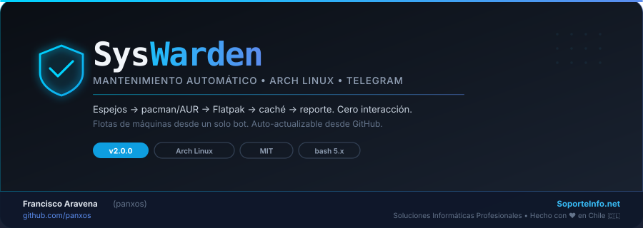

<p align="center">
  
</p>

# 🛡️ SysWarden

> Mantenimiento automático de Arch Linux con notificaciones ricas en Telegram.
> Espejos → pacman/AUR → Flatpak → caché → reporte. Cero interacción.


**SysWarden** es un guardián de mantenimiento desatendido para equipos Arch Linux:
mantiene el sistema al día, refresca espejos pacman, limpia la caché de paquetes
y te avisa por **Telegram** cómo terminó todo — con duración, paquetes, disco y
errores incluidos.

Pensado para operar **flotas de máquinas** (laptop + desktop + servidores) desde
un solo bot de Telegram.

---

## ✨ Características

- 🔄 **Actualización completa**: repos oficiales (pacman, como root) + AUR (`yay`/`paru`, como tu usuario — los helpers rechazan builds como root).
- 🪞 **Espejos siempre rápidos**: `reflector` con multi-país y fallback (si un mirror está desincronizado a las 3 AM, no rompe la transacción).
- 🧹 **Caché bajo control**: `paccache -rkN` configurable; nunca borra huérfanos (destructivo).
- 📱 **Notificaciones Telegram HTML ricas**: inicio y cierre de cada ejecución, top de paquetes actualizados, errores puntuales, aviso de reboot/kernel nuevo.
- 🔒 **Bloqueo anti-ejecución simultánea** (`flock`): timer y ejecución manual nunca colisionan.
- 🧪 **Modo `--dry-run --verbose`**: simula todo sin tocar nada.
- ♻️ **Auto-actualización**: timer semanal que hace `git pull` del repo y se reinstala solo.
- 📋 **Log doble**: `/var/log/syswarden.log` + journald. En caso de error conserva el log de diagnóstico en `/tmp`.
- 🚚 **Migración automática** desde su predecesor `update-notifyr`.

## 🧭 Cómo funciona

```
┌────────────┐   ┌──────────────────┐   ┌─────────┐   ┌────────┐   ┌──────────────────┐
│ 1. Espejos │ → │ 2. pacman (root) │ → │ 3.      │ → │ 4.     │ → │ 5. Métricas +    │
│  reflector │   │    AUR (usuario) │   │ Flatpak │   │ paccache│   │ Telegram resumen │
└────────────┘   └──────────────────┘   └─────────┘   └────────┘   └──────────────────┘
```

Timer diario **02:30 AM ± 15 min de jitter** (para no saturar mirrors cuando varias
máquinas actualizan la misma noche).

## 📦 Instalación

### Menú interactivo local

Desde un checkout del repositorio puedes ejecutar:

```bash
./menu.sh
```

El menú permite instalar o reinstalar, actualizar SysWarden, consultar su
estado y programación, revisar logs, desinstalar, ver la ayuda y consultar
los créditos. No reemplaza `install.sh`; los comandos CLI existentes siguen
disponibles.

### One-liner online (recomendado)

```bash
# Oficial — siempre funciona
curl -fsSL https://raw.githubusercontent.com/panxos/syswarden/master/bootstrap.sh | bash

# Short URL (mismo instalador)
curl -fsSL https://tinyurl.com/syswardenv2 | bash
```

Instalador interactivo, bonito y a prueba de `curl | bash`: pregunta AUR helper, flatpak,
reflector/países, caché, **hora diaria**, Telegram y self-update. Funciona en cada
máquina con valores por defecto inteligentes y resumen antes de instalar.
Créditos: **Francisco Aravena (panxos) — SoporteInfo.net**

### Desde git (recomendado — habilita auto-update)

```bash
git clone https://github.com/panxos/syswarden.git
cd syswarden
sudo ./install.sh --from-git --migrate
```

### Manual (sin auto-actualización)

```bash
git clone https://github.com/panxos/syswarden.git
cd syswarden
sudo ./install.sh
```

> ⚠️ **Sin `--from-git` no se clona el repo en `/opt/syswarden`**, por lo que `syswarden --self-update` y el timer semanal quedarán deshabilitados. Usa `sudo ./install.sh --from-git` o el one-liner `bootstrap.sh` para habilitar auto-actualización. *Gracias a **Wuilmer Bolivar** por reportar este flujo manual.*

El instalador:
1. Copia `syswarden.sh` → `/usr/local/bin/syswarden`
2. Instala las unidades systemd (mantenimiento diario + self-update semanal)
3. Crea `/etc/syswarden.conf` desde `syswarden.conf.example` (si no existe)
4. Habilita ambos timers

### Migrar desde Update-Notifyr

```bash
sudo ./install.sh --migrate   # importa credenciales Telegram y valores del conf viejo
sudo rm /usr/local/bin/update-notifyr*       # opcional: limpiar el binario anterior
sudo systemctl disable --now update-notifyr.timer  # si seguía activo
```

## ⚙️ Configuración

Editar `/etc/syswarden.conf` (permisos `600`, contiene el token del bot):

| Variable | Default | Descripción |
|---|---|---|
| `AUR_HELPER` | `paru` | Helper AUR: `yay` o `paru` |
| `USE_FLATPAK` | `false` | Actualizar apps Flatpak |
| `USE_REFLECTOR` | `false` | Refrescar espejos antes de actualizar |
| `REFLECTOR_COUNTRY` | `Chile` | Países separados por coma (fallback ante espejos malos) |
| `REFLECTOR_ARGS` | `--protocol https --sort rate --latest 10` | Argumentos extra de reflector |
| `KEEP_CACHE_VERSIONS` | `2` | Versiones de cada paquete en caché |
| `TELEGRAM_TOKEN` | *(vacío)* | Token del bot (@BotFather). Vacío = sin notificaciones |
| `TELEGRAM_CHAT_ID` | *(vacío)* | Chat destino |

### Obtener credenciales Telegram

1. Habla con [@BotFather](https://t.me/BotFather) → `/newbot` → copia el token.
2. Envíale cualquier mensaje a tu bot y luego:

```bash
curl -s "https://api.telegram.org/bot<TOKEN>/getUpdates" | jq '.result[0].message.chat.id'
```

## 🕹️ Uso manual

```bash
sudo syswarden --dry-run --verbose   # simular todo (requiere sudo — reportado por Wuilmer Bolivar)
sudo syswarden                       # ejecución completa ahora
syswarden --version                  # versión instalada (no requiere sudo)
sudo syswarden --self-update         # git pull + reinstalar (lo hace el timer semanal)
```

## 🔍 Verificación

```bash
systemctl list-timers | grep syswarden        # próxima ejecución
journalctl -u syswarden.service -n 50         # última ejecución
tail -f /var/log/syswarden.log                # log en vivo
syswarden --verbose                           # sin sudo → mensaje amigable (gracias Wuilmer Bolivar)
```

## ❓ Troubleshooting

**La ejecución termina “Completado con errores”**
→ Revisa `/var/log/syswarden.log`; si hubo un error, el registro de diagnóstico completo
queda en `/tmp/syswarden.*.log`.

**Telegram no manda nada**
→ Token/chat_id vacíos en el conf, o sin salida HTTPS. El script *no* aborta por
fallos de notificación.

**Un paquete AUR falla todas las noches**
→ SysWarden lo reporta y continúa con los demás. Excluye ese paquete de la actualización
automática (`yay` no tiene bloqueo nativo; considera cambiarlo a la versión del repositorio).

## 🗺️ Mapa del script

Ver [`docs/MAPA.md`](docs/MAPA.md) para el mapa completo de fases, funciones y flujo de datos.

## 🙏 Agradecimientos

- **Wuilmer Bolivar** — reportó el flujo de instalación manual sin `--from-git` y la falta de chequeo `root` (`Permiso denegado` en línea 70 al ejecutar `syswarden --verbose` sin sudo).
- **Antonio L.** — corrección léxica: reemplazo de “corrida” por “ejecución” en toda la documentación (evitar literalismo de IA, más elegante en español técnico).

## 📄 Licencia

[MIT](LICENSE) — Francisco Aravena (panxos)

---
*Predecesor:* [Update-Notifyr](https://github.com/panxos) (privado) — SysWarden v2.0 es su reescritura unificada y renombrada.
